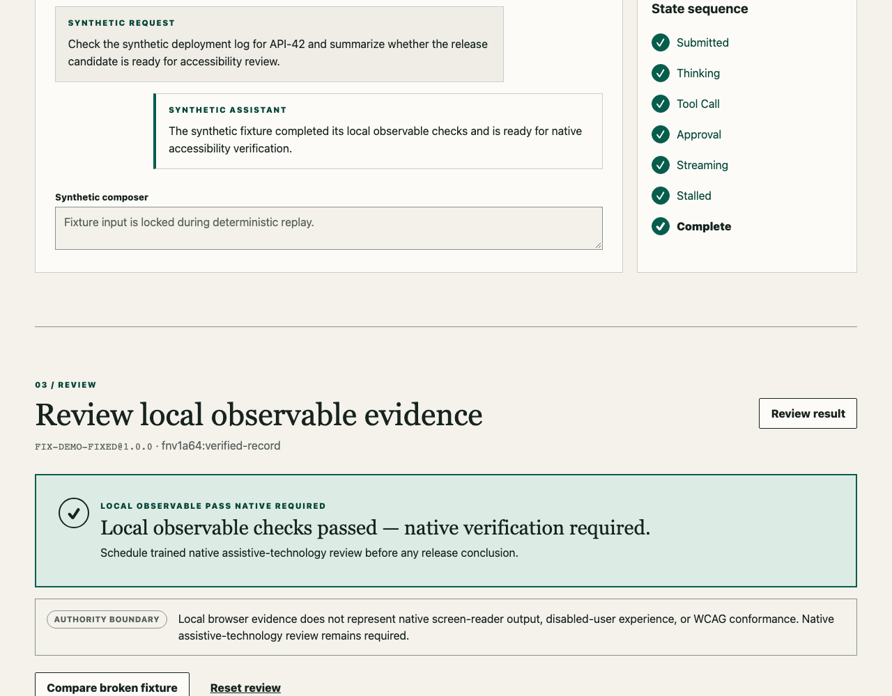

# StateChorus

> StateChorus helps accessibility QA engineers capture a real AI-interface turn,
> diagnose browser-observable state regressions, and carry evidence into native
> assistive-technology review.

The functional 1.1 candidate imports a JSON trace captured from a local or staging
interface, evaluates it entirely in the browser, and exports reviewable evidence.
A deliberately broken sample and its corrected equivalent remain available for
orientation. No API key, model, backend, or sign-in is required.

**Status:** Functional 1.1 candidate verified locally; production promotion and
fresh Stage 06 verification are pending. **Built:** November 2026. **Role:**
Product design and frontend engineering.
[Current public baseline](https://statechorus-eta.vercel.app/)
· [Source](https://github.com/nora-rasuli/statechorus)



StateChorus is a self-directed product. User-supplied traces are processed locally
and are not uploaded by the static application. Its local evidence does not
represent native screen-reader output, disabled-user experience, or WCAG
conformance.

## Why it exists

Streaming responses, tool calls, approval prompts, stalls, retries, and transcript
updates create an interaction lifecycle that static accessibility scans do not
fully describe. When a shared AI interface changes before release, an accessibility
QA engineer still needs to answer a narrower, useful question: which observable
promise changed, where is the evidence, and what must be checked by a trained native
reviewer?

StateChorus turns that review into one repeatable workflow. A small Playwright
adapter captures declared DOM observations from the team's own interface. The web
app validates and evaluates the trace against a versioned twelve-state contract,
groups events into semantic episodes, shows expected and observed behavior side by
side, and exports the raw facts, findings, provenance, and integrity hashes. A
local pass never becomes a screen-reader or conformance pass.

## Use it on your interface

1. Open StateChorus and download `statechorus-playwright-capture.ts`.
2. Mark the tested interface with the documented `data-statechorus-*` attributes.
3. Install the capture before `page.goto()`, exercise a complete AI turn, and save
   the trace from the same Playwright test.
4. Import the JSON trace into StateChorus. Invalid files fail visibly and are never
   replaced by sample data.
5. Review the expected-versus-observed timeline and download JSON or Markdown
   evidence.

The capture helper runs in the user's Playwright environment; the web app performs
analysis locally. StateChorus does not crawl arbitrary URLs or retain uploaded
traces.

```ts
import { test } from "@playwright/test";
import {
  installStateChorusCapture,
  saveStateChorusTrace,
} from "./statechorus-playwright-capture";

test("capture one real AI turn", async ({ page }) => {
  await installStateChorusCapture(page);
  await page.goto("http://127.0.0.1:3000/assistant");
  // Exercise the product's complete submit → approval → complete flow here.
  await saveStateChorusTrace(
    page,
    {
      traceId: "assistant-release-42",
      appName: "My assistant",
      url: page.url(),
      environment: "local",
    },
    "statechorus-trace.json",
  );
});
```

## Sample path

1. Start the production preview and open
   `http://127.0.0.1:4173/demo?fixture=FIX-DEMO-BROKEN`.
2. Run the broken fixture and approve one-time access to the bundled synthetic log.
3. Review the three local findings: excessive streaming mutations, a duplicate
   stalled episode, and unrequested DOM focus movement.
4. Run the corrected equivalent and approve the same synthetic tool request.
5. Confirm the result: **“Local observable checks passed — native verification
   required.”**
6. Inspect or download the JSON and Markdown evidence artifact.

The sample scenario, release, conversation, tool call, and results are synthetic.
They reset on reload and are not evidence about another product.

## Product decisions

### Observe the rendered interface, not the fixture flags

The hardest decision was defining what the product could truthfully know. Fixture
flags alter the rendered React replay, but `BrowserDomProvider@1.1.0` receives only
a DOM root. It queries state markers, live-status revisions and text, active-element
changes, approval-control reachability, transcript identity and content, and
retained status elements. Pure modules then normalize events, group episodes,
evaluate invariants, and serialize evidence.

That boundary costs more work than deriving expected failures directly from fixture
metadata, but it keeps the diagnosis tied to observable behavior. Native speech,
assistive-technology behavior, disabled-user experience, and conformance remain
outside the provider’s authority.

### Preserve distinct failure states

The interface does not collapse every problem into pass/fail. Contract violation,
invalid fixture, invalid run, inconclusive evidence, interruption, and local-pass /
native-required are separate result types with scoped recovery actions. Missing
signals fail closed; reviewer annotation can record only `not_ready` or
`requires_native_verification` and cannot rewrite captured evidence.

### Make provenance part of the user outcome

The review is not complete until it can leave the interface. JSON and Markdown
exports retain contract, input identity, capture provider/environment, analysis
environment, attempt, raw events, normalized events, findings, result, and
reproducible hashes. Sample exports separately retain their fixture identity.
Export is blocked when required lineage is missing.

## Architecture

```text
real local/staging AI interface
        ↓ Playwright capture adapter
user-controlled JSON trace
        ↓ local schema validation
normalizer → episode reducer → invariant evaluator
        ↓
review UI + integrity-checked JSON/Markdown evidence
        ↓
trained native assistive-technology review

optional bundled sample → same evaluator and review UI
```

The application is a static React 18 + TypeScript + Vite build. Contract, capture,
import validation, replay, evaluator, UI, and serializer boundaries are separately
typed. There is no server, database, remote model, telemetry SDK, authentication
flow, arbitrary URL runner, or server-side upload path.

### Version model

StateChorus uses independent versions for independently evolving boundaries. The
current application release, imported-trace schema, and in-app
`BrowserDomProvider` are `1.1.0`. The separately downloaded
`StateChorusPlaywrightCapture` helper/provider, evaluation contract, and
exported-evidence schema remain `1.0.0`; those numbers identify their own stable
interfaces rather than the application release. Every export records the relevant
versions so a reviewer can reproduce the exact combination that produced a result.

The architecture rationale is recorded in
[ADR-001](evidence/architecture/ADR-001-local-observable-authority.md).

## Independent verification changed the product

The verifier loop found issues that a green happy-path build had missed:

1. Browser evidence was originally too close to fixture-authored expectations.
   The provider was separated from fixture metadata and the corpus was rerun from
   rendered behavior.
2. The corrected-sample rerun lost keyboard focus. The run control now remains a
   stable focus target and approval is the next ordinary Tab stop.
3. The first real-input implementation accepted a transition-free trace. Imported
   runs now require the complete ordered trajectory, state-consistent events,
   required semantic signals, and terminal completion.
4. Early exports described user input with fixture-shaped lineage. User traces now
   carry trace-native identity and separate capture and analysis environments;
   only sample exports retain fixture lineage.

A fresh independent Stage 03 verification reproduced a non-corpus capture in one
browser context, imported it in a second context, recomputed both hashes, exercised
six semantic failure derivatives, and passed the complete gate. Stage 04 release
audit and production verification are recorded separately so a local pass cannot
be mistaken for a deployed result. See the [claim ledger](claim-ledger.md).

## Verified quality evidence

The package 1.1 functional-path checks are dated 2026-11-19. They include a fresh,
non-corpus user-trace import, malformed-input recovery, provenance-aware export,
and the existing deterministic sample corpus.

- **Evaluation:** eight sample fixtures ran three times each in Chromium: all seven seeded
  rendered failures were detected, the corrected control produced zero false
  findings, and each fixture produced one comparable output hash across its three
  runs.
- **Functional path:** a fresh trace with user-controlled source metadata is
  imported and exported in Playwright; a malformed trace fails without evaluating
  or substituting sample data.
- **Accessibility checks:** axe-core 4.10.1 reported zero violations in the tested
  setup and completed-review states. Keyboard/focus, selected contrast tokens,
  360/768/1280 layouts, 200%/400%-equivalent reflow, and reduced motion were also
  checked. These automated and local results are not WCAG certification and do not
  substitute for native screen-reader or disabled-user testing; neither was run.
- **Privacy/runtime:** a recorded local flow loaded three same-origin static assets,
  then made zero post-load and zero external requests.
- **Bundle:** the repaired build produced 194.69 kB JavaScript raw / 60.96 kB gzip
  and 13.44 kB CSS raw / 3.65 kB gzip.

The historical Lighthouse profile predates the final bounded repair and is retained
only as internal context, not as current public release evidence. Full methods and
limits are in the [claim ledger](claim-ledger.md).

## Testing and CI

The local release gate covers formatting, ESLint, strict TypeScript, unit/component
tests, the rendered fixture corpus, production build, Playwright workflows,
axe-core, responsive/reflow profiles, reduced motion, network capture, contrast
tokens, provenance, dependency licenses, and claim vocabulary.

The repository contains a GitHub Actions workflow that runs the same root gate on
every push and pull request.

## Run locally

### Prerequisites

- Node.js 20.19 or newer
- npm 10 or newer

```bash
npm ci
npm run verify
npm run preview -- --port 4173
```

Open `http://127.0.0.1:4173/` to import a trace, or use
`/demo?fixture=FIX-DEMO-BROKEN` for the optional sample.

For development:

```bash
npm run dev
```

No environment file, account, key, model, or paid service is required.

## Data, privacy, and limitations

- The bundled sample's personas, release identifiers, conversations, tool calls,
  and results are synthetic. User traces come from the user's own test environment.
- Imported files are capped at 5 MB, processed in browser memory, and not uploaded
  by this static application. Users remain responsible for removing secrets and
  personal data before capture.
- Local observations cover event order, DOM focus, control reachability, transcript
  identity/content, and live-region mutations within the declared provider scope.
- Native NVDA, VoiceOver, JAWS, TalkBack, and other assistive-technology output was
  not tested. Disabled-user testing was not performed.
- Automated accessibility results do not establish WCAG conformance,
  certification, compliance, legal safety, or a safe release decision.
- Performance measurements are dated local profiles, not production reliability,
  compatibility, support, or an SLA.
- There is no customer, adoption, revenue, ROI, time-saving, production-impact, or
  commercial-validation evidence.
- StateChorus is an independent portfolio product; the working name has a dated
  collision screen but no trademark-clearance claim.

## Roadmap

1. Run moderated contract-authoring sessions with accessibility QA and frontend
   platform practitioners to test whether the schema fits their release workflow.
2. Pair the same fixture cases with qualified native assistive-technology review
   and study correlation without weakening the authority boundary.
3. Package the capture helper for npm and add CI output only after the current
   adapter and schema have been tested with multiple real interface structures.

## License

The source package includes the [MIT License](LICENSE), matching `package.json`.
The synthetic fixtures and interface are original to this project; dependency
declarations are inventoried in `evidence/licenses/`. The inventory is not legal
advice.
