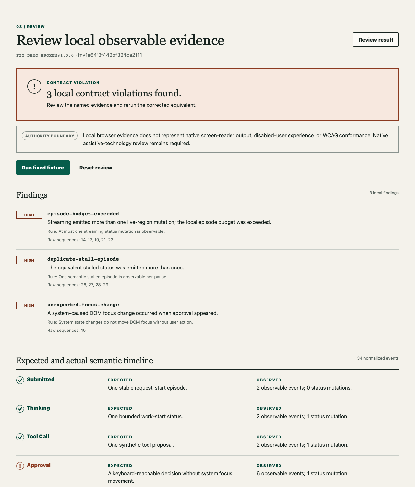

# StateChorus — Portfolio Case Study

## Card copy

- **One-line description:** Replay an AI-interface state contract, diagnose local
  regressions, and route the remaining questions to native accessibility review.
- **Role:** Product design and frontend engineering
- **Timeline:** One-week independent build · November 2026
- **Stack:** React, TypeScript, Vite, Vitest, Playwright, axe-core
- **Project type:** Self-directed product concept using synthetic fixtures
- **Links:** [Live demo](https://statechorus.vercel.app/demo?fixture=FIX-DEMO-BROKEN)
  · [Source](https://github.com/nora-rasuli/statechorus)

## A release-evidence workbench for AI interface states

Streaming text is only one part of an AI interface. A realistic turn can submit,
think, propose a tool, wait for approval, stream, stall, retry, and finish while
focus and transcript state change around it. StateChorus gives an accessibility QA
engineer a repeatable way to review that lifecycle: replay a versioned contract,
compare expected and browser-observable episodes, inspect the exact mismatch, and
export evidence for the native review that still has to happen.

The project uses a fictional release and bundled synthetic interaction fixtures.
It has no customer, adoption, revenue, ROI, or production-impact evidence. Local
DOM evidence is deliberately not presented as native screen-reader output,
disabled-user experience, or WCAG conformance.

| Role                                    | Timeline                                  | Stack                               | Status                                       |
| --------------------------------------- | ----------------------------------------- | ----------------------------------- | -------------------------------------------- |
| Product design and frontend engineering | One-week independent build, November 2026 | React, TypeScript, Vite, Playwright | Public portfolio release |

## The painful moment

The target user is an accessibility QA engineer reviewing a shared web AI component
just before release. The change touches streaming updates, a tool-approval prompt,
and a stalled state. Static rules can inspect the final DOM, and native review can
evaluate real assistive-technology behavior, but the team still needs a durable
account of the interaction lifecycle: which state promise failed, which observable
events support that conclusion, and which questions remain outside local authority?

The core user story is:

> As an accessibility QA engineer reviewing an AI-interface change, I need to
> replay a versioned semantic contract and inspect the exact observable mismatch so
> that I can reject a local regression or send a well-scoped case to authoritative
> native review.

Formal user research and customer outreach were outside the authorized build scope.
The persona, buying hypothesis, and workflow were derived from public issue reports,
browser regressions, specialist practice, and adjacent tooling; they remain
assumptions to validate with practitioners.

## The product approach

The demo is one continuous release review, not a dashboard of disconnected checks.

| Step                        | User intent                                      | Interface response                                                                               | Why it is designed this way                                            |
| --------------------------- | ------------------------------------------------ | ------------------------------------------------------------------------------------------------ | ---------------------------------------------------------------------- |
| 1. Establish authority      | Understand what the tool can and cannot conclude | The first screen names local, native, and human authority and marks the scenario synthetic       | The limitation is part of the task, not a footnote after a pass state  |
| 2. Reproduce the regression | Run the exact release-change lifecycle           | A seven-state replay pauses for a real keyboard-reachable approval action                        | The approval moment makes focus ownership and state order observable   |
| 3. Diagnose                 | Find the broken promise and evidence             | Three findings link human explanations to expected rules and raw sequence numbers                | Reviewers can move from summary to evidence without reading test code  |
| 4. Compare the correction   | Re-run the equivalent scenario                   | The corrected fixture uses the same contract and ends with zero local findings                   | The comparison changes behavior, not the problem definition            |
| 5. Preserve the review      | Carry the result into the next authority         | JSON and Markdown include raw and normalized events, versions, environment, findings, and hashes | A release review needs portable lineage, not a screenshot-only verdict |

### Broken-to-fixed demonstration



The broken fixture produces three high-severity local findings:

- `episode-budget-exceeded`: five streaming status mutations exceed the contract’s
  single-mutation budget.
- `duplicate-stall-episode`: the equivalent stalled status appears four times.
- `unexpected-focus-change`: the system moves DOM focus when approval appears.


The corrected equivalent produces no local contract finding, but its result remains
“Local observable checks passed — native verification required.” The interface
never offers an accessible, compliant, safe, or screen-reader-pass result.

## The hardest decision: choosing an honest evidence boundary

The main engineering risk was not rendering the timeline. It was making sure the
timeline could not say more than the product had actually observed.

One tempting design was to let the fixture definition emit the raw events directly.
That was deterministic and easy to test, but it would allow fixture metadata to
manufacture the evidence that supposedly proved rendered behavior. Another option
was to simulate a speech layer, which would look closer to a screen-reader test but
would blur browser mutations with native output.

I chose a narrower provider contract. Fixture flags affect the rendered React
surface. `BrowserDomProvider@1.1.0` accepts only a DOM root and captures state,
status revision/text, active-element changes, approval-control reachability,
transcript identity/content, and retained statuses. The evaluator never reads the
fixture’s expected findings to create observations. It consumes captured events,
normalizes them, reduces them into episodes, and evaluates contract invariants.

The tradeoff is explicit: StateChorus can detect and explain only the signals in
its declared local scope. Native speech and lived usability require another
authority. That constraint is also what makes the evidence credible.

## State and evidence architecture

```text
versioned contract + synthetic fixture
                ↓
     deterministic React replay
                ↓
  BrowserDomProvider captures DOM facts
                ↓
 normalize → group episodes → evaluate
                ↓
 expected/observed review + findings
                ↓
 immutable JSON/Markdown evidence
                ↓
 trained native accessibility review
```

The contract models twelve states; the polished demo exercises the seven-state
path `submitted → thinking → tool_call → approval → streaming → stalled →
complete`. Invalid fixture, invalid run, inconclusive, interrupted, contract
violation, and local-pass/native-required remain separate results. A virtual clock
and stable sequence numbers make comparable fixture output deterministic; wall
clock time is lineage only.

## Independent verification found what the happy path missed

The validation process was intentionally separate from implementation. It changed
the product twice.

### 1. The “browser-observable” evidence was not yet browser-observed

The first Stage 03 review traced the provider data flow instead of accepting the
green tests. It found that several seeded failures were created from fixture flags
and labeled `browser_dom` even though the provider never queried the rendered
interface. The same review found non-reproducible contract hashing, browser recovery
gaps for invalid/inconclusive results, and a nested complementary landmark issue.

The correction moved every defect into rendered behavior; made the provider accept
only a DOM root; separated raw from normalized events; added hash validation and a
flag-only negative regression; exposed fail-closed degraded states in browser tests;
and corrected the landmark. A fresh validator then reproduced all 24 corpus
attempts before returning `PASS`.

### 2. The complete correction loop dropped keyboard focus

The independent release audit did not stop at the setup-to-review path. It activated
**Run fixed fixture** from the broken review with the keyboard and observed that
the focused button unmounted, leaving focus on `BODY` when approval appeared. That
was release-blocking in a product whose central promise includes focus contracts.

The bounded repair transfers focus to the persistent canonical Run control before
the review action unmounts. One ordinary Tab then reaches the approval control;
approval returns focus to the synthetic composer; completion does not move focus;
**Review result** moves focus only on request; reset returns it to Run. Fresh Stage
03 and Stage 04 reviewers reproduced the complete sequence in ordinary Chrome and
in a separate reduced-motion flow.

This loop is the strongest outcome of the project: independent evidence did not
just confirm the implementation; it exposed two credibility failures and forced
the product to match its own authority and focus contracts.

## Quality as a product feature

### Deterministic evaluation

The frozen corpus contains seven single-defect fixtures and one corrected control.
On 2026-11-19, the independent audit ran each three times in rendered Chromium:
seven of seven seeded failures were detected, the fixed control produced zero false
findings, and every fixture produced one comparable output hash across all three
runs. This is evidence about a synthetic declared-local corpus, not model accuracy
or production defect-prevention.

### Accessibility

The complete keyboard and focus path, responsive layouts at 360/768/1280, 200% and
400%-equivalent reflow, selected contrast tokens, reduced motion, semantic
structure, and axe-core 4.10.1 were checked. The final audit reported zero axe
violations in the two tested states. Native screen-reader testing and testing with
disabled users were not performed; automated results are not WCAG certification.

### Performance and privacy

The independent Stage 04 release gate completed in 53.78 seconds on the recorded
macOS 15.7.4 / Node 20.19.5 environment. The production build measured 183.80 kB
JavaScript raw / 57.96 kB gzip and 12.42 kB CSS raw / 3.48 kB gzip. A local runtime
capture observed three same-origin static-load requests and zero post-load or
external requests. These are dated local profiles, not production SLAs or public
reliability evidence.

### Verification coverage

The release gate combined 25 Vitest checks, 24 rendered-browser corpus attempts,
15 Playwright checks, build/type/lint/format checks, axe-core, responsive/reflow,
reduced motion, privacy/network, contrast-token, provenance, license, and claim
review. The GitHub Actions definition mirrors the local gate, but it has no hosted
run until publication.

## Scope choices

I deliberately excluded a backend, accounts, hosted run history, production
conversation ingestion, remote models, automatic remediation, and a native
NVDA/VoiceOver/JAWS provider. Those additions would expand privacy and authority
before the core contract and reviewer workflow had practitioner validation.

The MVP is intentionally one complete journey: reproduce, diagnose, compare,
export, and route. It does not claim customer validation or production use.

## Verified outcome

| Result                                                                                            | Type                             | Method/source                                              |
| ------------------------------------------------------------------------------------------------- | -------------------------------- | ---------------------------------------------------------- |
| Twelve-state typed contract; exact seven-state executable demo                                    | Verified artifact                | Frozen package 1.0, source, unit and browser checks        |
| 7/7 seeded failures, zero fixed false findings, one comparable hash per fixture across three runs | Measured synthetic-corpus result | 24 Chromium attempts, independent audit, 2026-11-19        |
| Complete keyboard rerun retains a canonical focus target                                          | Measured interaction result      | Ordinary-Chrome Stage 03 and Stage 04 rechecks, 2026-11-19 |
| 25 Vitest, 24 corpus attempts, 15 Playwright checks; full gate 53.78 s                            | Measured local release result    | Stage 04 audit recheck, recorded environment, 2026-11-19   |
| Zero axe violations in tested setup/review states                                                 | Qualified automated result       | axe-core 4.10.1; not conformance or native-user evidence   |
| Local pass still routes to native review                                                          | Verified product behavior        | UI, types, exports, browser inspection                     |
| Customer value, adoption, ROI, prevention, production reliability                                 | Not evidenced                    | Withheld from public claims                                |

## What I would learn next

1. Watch accessibility QA and frontend-platform practitioners author or adapt a
   contract. The key unknown is whether the schema reduces real release-review
   friction without duplicating existing tests.
2. Run the synthetic cases through qualified native assistive-technology review and
   compare the evidence, without treating correlation as proven in advance.
3. Use that evidence to decide whether a CI adapter, native-provider integration,
   or a smaller contract-authoring tool is the right next product step.

## Interview version

“I built StateChorus for accessibility QA engineers reviewing stateful AI interface
changes. It replays a versioned turn contract, captures local DOM events, explains
broken episodes, and exports evidence for native review. The hardest decision was
limiting the provider to what it could actually observe; a local pass never becomes
a screen-reader or WCAG pass. Independent verification caught two release blockers:
the first implementation was deriving several ‘observations’ from fixture metadata,
and the complete keyboard rerun later dropped focus to the document body. I repaired
both and had fresh validators reproduce the full corpus and focus loop. The final
audit ran 24 corpus attempts with all seven seeded failures detected, no fixed-control
false finding, and deterministic output per fixture. Next I would validate contract
authoring with practitioners and pair the same fixtures with qualified native
assistive-technology review.”
