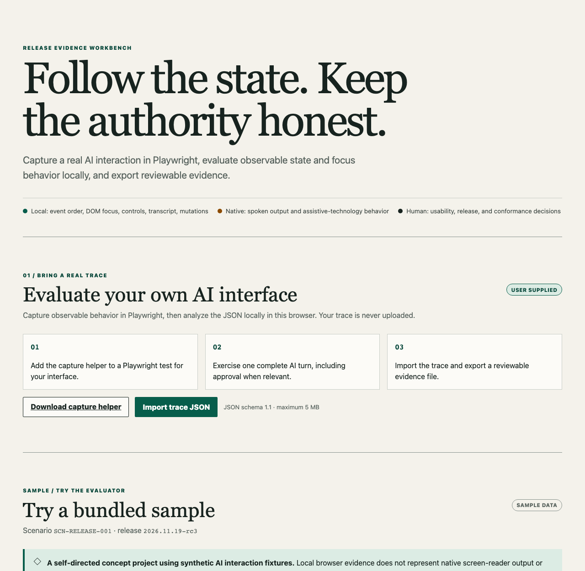
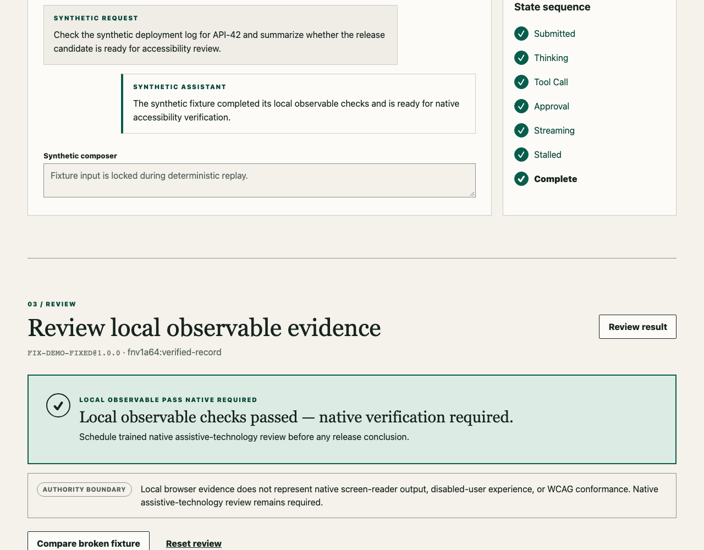

# StateChorus — Portfolio Case Study

## Project card

- **What it is:** A release-evidence workbench for complex AI-interface states.
- **Who it is for:** Accessibility QA engineers and frontend platform teams.
- **Role:** Product design and frontend engineering.
- **Timeline:** One-week independent build · November 2026.
- **Stack:** React, TypeScript, Vite, Vitest, Playwright, axe-core.
- **Links:** [Current public baseline](https://statechorus-eta.vercel.app/) ·
  [Source](https://github.com/nora-rasuli/statechorus).

This case study documents functional release candidate 1.1. The public URL and
repository remain on the earlier sample-led release until Stage 05 promotion; the
exact deployed candidate is verified separately in Stage 06.

## The problem

An AI interface does not move directly from question to answer. It may submit,
think, call a tool, ask for approval, stream, stall, recover, and finish while
focus, live regions, and the transcript all change. A static scan sees snapshots;
a release reviewer needs the sequence.

The practical question is: **when an AI workflow changes, which observable state
promise changed, what evidence supports that conclusion, and what still requires
native assistive-technology or human review?**

The primary user story is:

> As an accessibility QA engineer reviewing an AI-interface release, I want to
> capture one complete interaction and compare its observable state, focus, and
> transcript behavior with a versioned contract so I can diagnose a regression and
> hand off trustworthy evidence.

## The product

StateChorus turns that job into one continuous workflow:

1. Download a small Playwright capture helper.
2. Add explicit `data-statechorus-*` markers to a local or staging interface.
3. Exercise a complete AI turn, including approval when relevant.
4. Import the captured JSON into StateChorus.
5. Review expected and observed episodes, findings, and raw sequence pointers.
6. Export integrity-checked JSON or Markdown for the release record.

The app is static and account-free. Imported traces stay in browser memory and are
not uploaded by StateChorus. A bundled broken/fixed sample is available for
orientation, but it is not the product's primary input.



## Product decisions

### Make real input the first action

The first version led with a polished synthetic replay. It demonstrated the idea,
but it did not solve a user's job. The release was reworked around a downloadable
capture adapter and strict local import. The sample moved below the real workflow
and malformed files fail visibly without silently falling back to canned data.

### Fail closed on incomplete evidence

A valid trace must contain the exact complete contract path:

`idle → submitted → thinking → tool_call → approval → streaming → stalled → complete`

StateChorus checks transition order, transition/event state consistency, required
signals, and terminal completion before it evaluates findings. Removing,
reordering, or contradicting any required part produces `invalid_run`; it can never
produce a local pass.

### Keep capture and analysis provenance separate

The capture helper records the browser, operating system, viewport, reduced-motion
setting, source label, and trace identity from the interface under test. The web
app separately records the analysis environment. User-trace exports have
trace-native identity; only bundled samples carry fixture lineage. Both the source
trace and final artifact have recomputable hashes.

### Keep the authority boundary visible

StateChorus can evaluate browser-observable state, focus, control reachability,
transcript content, and live-region mutations. It cannot report what a screen
reader spoke, how a disabled user experienced the task, or whether a release
conforms to WCAG. A clean local result therefore says **“native verification
required,”** not “accessible” or “safe to ship.”

## Architecture

```text
local/staging AI interface
        ↓ Playwright capture helper
user-controlled trace JSON
        ↓ schema + semantic validation
normalizer → episode reducer → invariant evaluator
        ↓
review UI + integrity-checked JSON/Markdown
        ↓
native assistive-technology and human review

optional sample → same evaluator and review UI
```

The evaluator, capture schema, import validator, episode reducer, UI, and evidence
serializer are typed boundaries. There is no server, database, authentication,
telemetry SDK, model call, or arbitrary URL runner.

## What the interface reveals

The optional broken sample makes three failure classes easy to inspect: excessive
streaming mutations, repeated stalled episodes, and an unexpected focus move. The
corrected equivalent uses the same contract and ends with no local finding while
preserving the native-review requirement.




## Verification and iteration

Independent review materially changed the product:

- Evidence collection was decoupled from fixture-authored expectations.
- A keyboard-focus regression in the corrected rerun was repaired.
- The real-input path was added after the initial sample-only release was judged
  non-functional.
- Transition-free and semantically incomplete traces were made fail-closed.
- Fixture-shaped identity was removed from user-trace exports.

The current candidate passed a fresh cross-context functional verification using a
verifier-owned AI-like interface—not a bundled sample. The verifier captured a
real transient approval at 1440×900 with reduced motion, imported at 390×844 in a
separate browser context, downloaded JSON and Markdown, recomputed both hashes,
and confirmed six incomplete or incoherent variants failed visibly.

The complete release gate passed with:

- 42/42 Vitest checks;
- 24/24 browser-captured sample-corpus attempts;
- 19/19 Playwright checks, including a mobile real-input axe and keyboard case;
- zero serious or critical automated accessibility violations in audited states;
- provenance, privacy, contrast, license, claim, build, and strict TypeScript
  checks; and
- a 194.69 kB JavaScript build (60.96 kB gzip) plus 13.44 kB CSS (3.65 kB gzip).

These are dated local verification results, not production reliability, WCAG
conformance, or disabled-user validation.

## Outcome

StateChorus now has a useful primary path: teams can bring evidence from their own
interface, receive a strict and explainable local result, and carry a verifiable
artifact into the next review authority. The work demonstrates product framing,
accessible interaction design, typed frontend architecture, deterministic testing,
provenance design, failure-mode thinking, and an audit-driven release process.

## Next product experiments

1. Test the capture schema with three structurally different AI interfaces.
2. Run workflow interviews with accessibility QA and frontend platform engineers.
3. Pair captured traces with qualified native assistive-technology review to learn
   which local signals are useful predictors without turning correlation into a
   conformance claim.
4. Package the capture helper only after the adapter has survived those interface
   variations.
